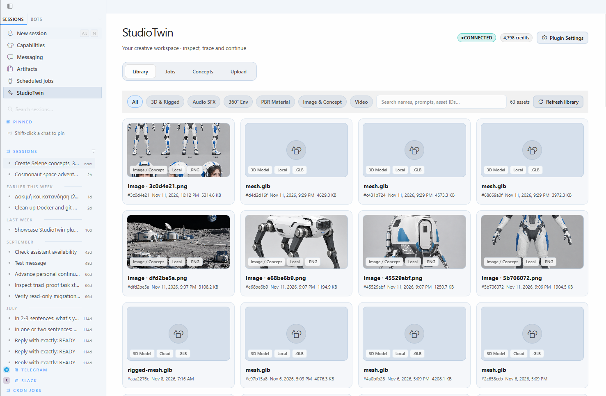
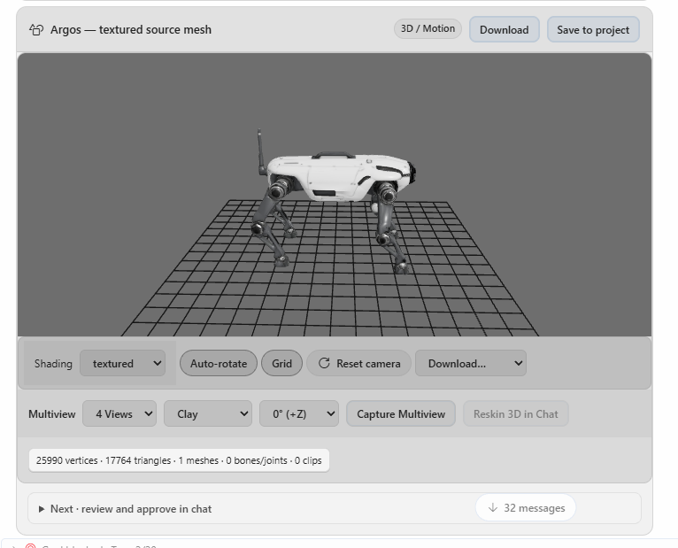
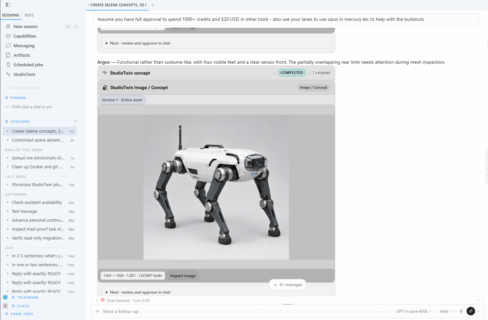
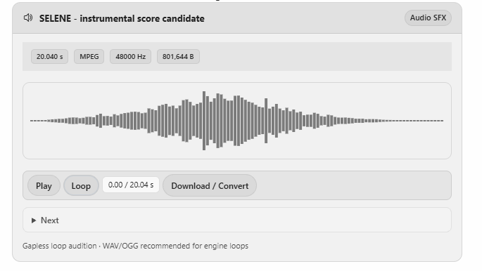
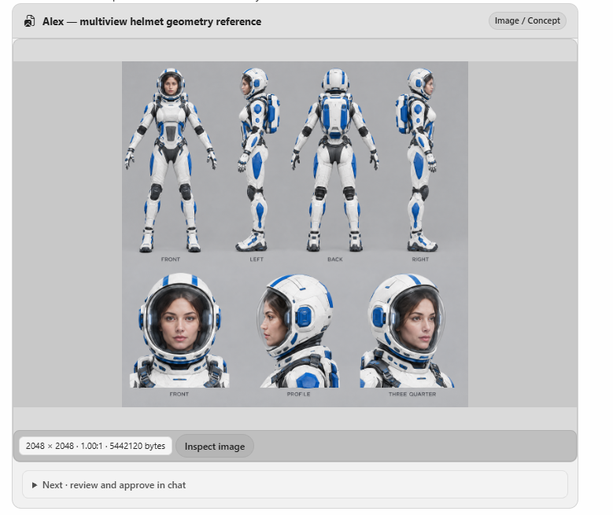
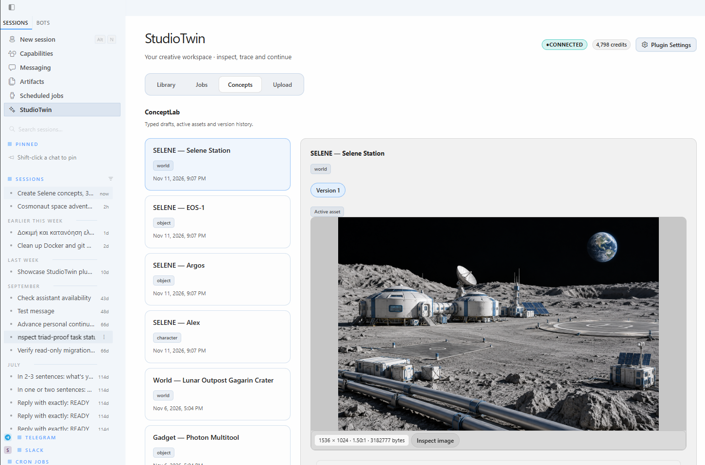
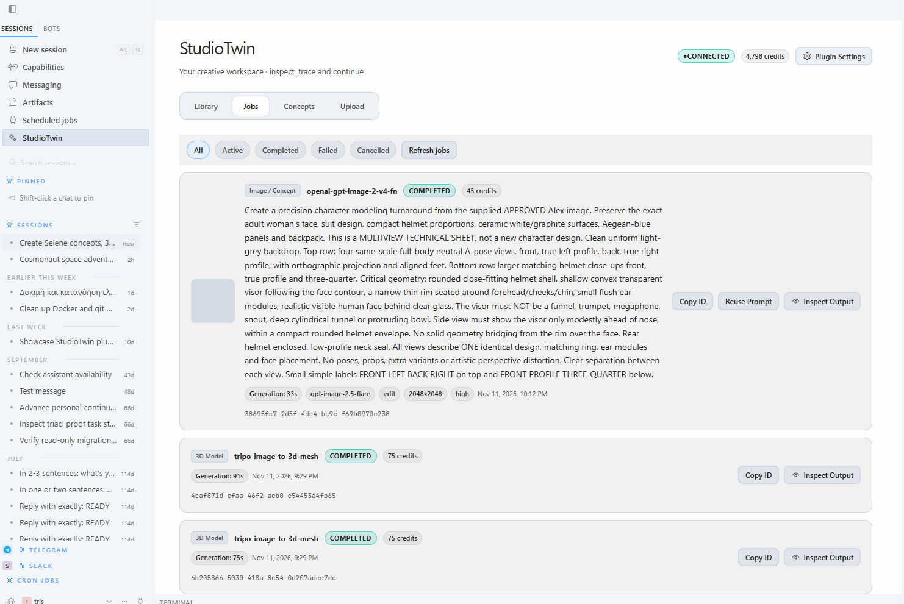

# StudioTwin Desktop screenshots

Maintainer-provided screenshots of the StudioTwin plugin in Hermes Desktop. The images below are included as supplied, without additional cropping, compositing, or restyling.

## Library

## 3D model

## Inline card in Desktop

## Audio

## Character concept

## Scene concept

## Jobs

Screenshots are illustrative snapshots. Displayed credits, prices, job states, and sample asset metadata are not live values or a compatibility guarantee.
